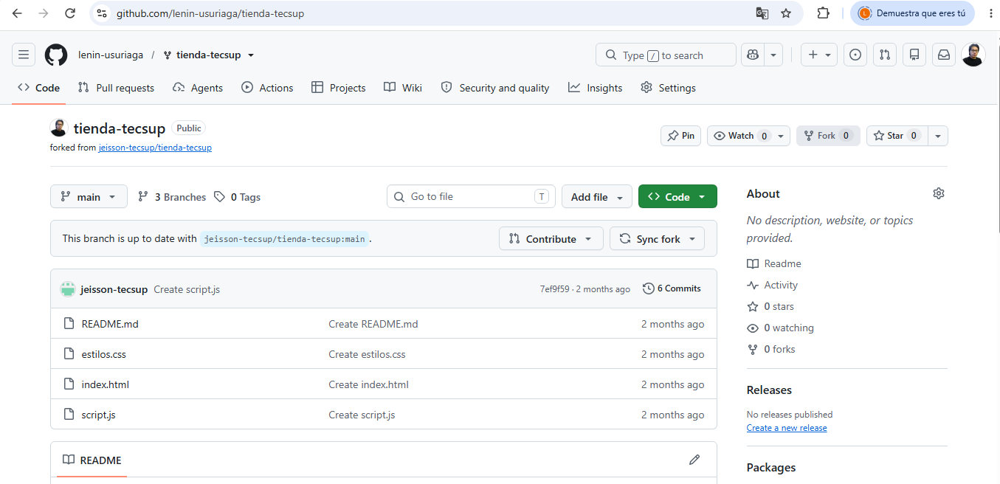

# Guia del proyecto: tienda-tecsup

Esta guia explica como corregir un error real en un proyecto ajeno usando fork, issue y pull request. Esta escrita para un companero que nunca vio el proyecto.

## Que necesitas

- Git instalado y configurado
- Visual Studio Code
- Una cuenta en GitHub
- El enlace del repositorio original del docente

## El problema

La pagina del carrito mostraba un total de S/ 43.00 cuando debia mostrar S/ 68.00. La funcion `calcularTotal` sumaba el precio de cada producto sin multiplicarlo por la cantidad.

## Como corregirlo

1. Haz un fork del repositorio del docente desde GitHub
2. Clona tu fork con `git clone`
3. Reporta el error con un Issue en el repositorio original
4. Crea una rama llamada `fix-total-carrito`
5. Corrige la linea en `script.js` y comprueba el resultado en el navegador
6. Haz commit, sube la rama y abre un Pull Request

### Comandos usados

```powershell
git clone https://github.com/lenin-usuriaga/tienda-tecsup.git
cd tienda-tecsup
git checkout -b fix-total-carrito
git add script.js
git commit -m "Corrige el calculo del total del carrito (#1)"
git push origin fix-total-carrito
```

### La correccion en script.js

```javascript
// Antes
total = total + producto.precio;

// Despues
total = total + producto.precio * producto.cantidad;
```

## Archivos del proyecto

| Archivo | Para que sirve |
| --- | --- |
| index.html | La pagina con la tabla del carrito y el total |
| estilos.css | Los colores y la tipografia |
| script.js | El calculo del total del carrito |
| README.md | La descripcion y el resultado esperado |

## Mi avance

- [x] Hacer el fork y clonarlo
- [x] Reportar el error con un Issue
- [x] Corregir el codigo en una rama propia
- [x] Abrir el Pull Request
- [ ] Que el docente acepte el Pull Request

## Mas informacion

Consulta la [documentacion oficial de GitHub sobre forks](https://docs.github.com/es/pull-requests/collaborating-with-pull-requests/working-with-forks/about-forks).


